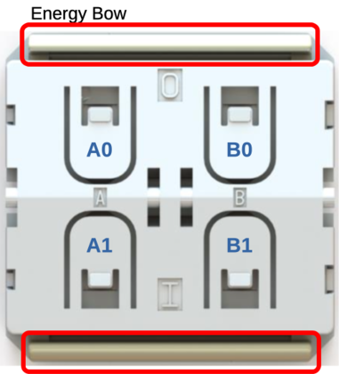

# EnOcean BLE (PTM 215B/PTM 216B) for Home Assistant

`enocean_ble` is a Home Assistant custom integration for EnOcean BLE
energy-harvesting switches (PTM 215B/PTM 216B).

It provides:
- Bluetooth discovery + guided commissioning flow
- Secure telegram parsing (MIC verification)
- Button events as native Home Assistant `event` entities, in the button mode you choose:
  one action per button, short + long press, or short press + hold (for dimming)
- Diagnostic sensors: signal, last seen, receiver, lost messages

## Supported Devices

- EnOcean PTM 215B
- EnOcean PTM 216B

## Installation

### Marketplace (Home Assistant 2026.11 and later)
1. Settings -> `Marketplace`
2. Search for `EnOcean BLE Switches` and install it
3. Restart Home Assistant

### HACS (Home Assistant before 2026.11)
1. HACS -> search for `EnOcean BLE Switches` (no custom repository needed)
2. Download it
3. Restart Home Assistant

### Manual
1. Copy [`custom_components/enocean_ble`](custom_components/enocean_ble) to your HA `custom_components` directory
2. Restart Home Assistant
3. Add your switches as described below

## Add Your Device

1. Press any button on the switch — it will appear as a discovered device in Home Assistant
   (Settings -> Devices & Services).
2. Click `Add` when it appears, then choose how to add it:
   - **Scan the QR code with the camera**
   - **Enter the QR code text**
   - **Manual commissioning (button sequence)**
3. Choose the [button mode](#button-modes) of the switch.

Switches are always added from their discovery: this guarantees the switch is present, and lets the
integration check the QR code against a telegram really received from it.

### From the QR code (scan or text)

The QR code on the PTM 215B/216B module label (behind the rocker) contains the switch address and
its security key, for example `30SE215…+Z…+30P…`. No button sequence is needed, which also makes
it the way to add OEM switches whose radio commissioning is disabled (for example Busch-Jaeger
6716 UBT and Jung BLE switches).

- **Scan:** a scan page opens. On a phone it uses the camera (it can also read a photo of the
  label). On a computer it shows a QR code to open the page on your phone. Camera access needs
  Home Assistant to be reached over **HTTPS**; without it, enter the text instead.
- **Text:** type or paste the QR code text (for example read with your phone's camera app).
  Only two parts are needed: the address after `30S` (12 characters) and the security key after
  `+Z` (32 characters), for example `30SE21500001234+Z0123456789ABCDEF0123456789ABCDEF`. The
  other parts (`+30P…` product, `+2P…` revision, `+S…` serial number) are not used and can be
  left out.

Before the switch is added, the integration checks that:
- the text is an EnOcean module QR code,
- its address is the address of the discovered switch,
- its key verifies a telegram received from that switch (MIC check). If the switch was
  reconfigured (for example by another system), the key no longer matches and the switch is not
  added.

Treat the QR code like a password: anyone with the key can create valid button telegrams for
that switch.

### Manual commissioning (button sequence)

1. Follow the sequence on button 1:
   - hold for about 7 seconds,
   - press briefly,
   - hold again for about 7 seconds.
2. When the confirmation screen appears, press another button (not button 1) to exit commissioning mode.
3. Click `Submit`.

Notes:
- If the switch is already in commissioning mode, progress can complete almost immediately.
- After success, press another button to ensure the switch exits commissioning mode.

## Button modes

Each switch has a **button mode**. You choose it when you add the switch, and you can change it
later with the `Configure` button of the switch.

| Mode | Actions per button | When the action runs | If a telegram is lost |
|---|---|---|---|
| **Simple** | `single_press` | as soon as you press | still works (most reliable) |
| **Short + long** | `short_press`, `long_press` | when you release: under 1 s → short, 1 s or more → long | the action is lost, never a wrong one |
| **Short + hold** | `short_press`, `hold_press`, `hold_release` | short: on release before 1 s. hold: at 1 s, while held. hold_release: on release | the action is lost, or a hold runs for up to 8 s |

This page uses the English mode names. Home Assistant shows them in its language:

| Language | Simple | Short + long | Short + hold | Legacy |
|---|---|---|---|---|
| cs | Jednoduchý | Krátký + dlouhý | Krátký + držení | Starý |
| de | Einfach | Kurz + lang | Kurz + halten | Legacy |
| en | Simple | Short + long | Short + hold | Legacy |
| es | Simple | Corto + largo | Corto + mantener | Antiguo |
| fr | Simple | Court + long | Court + maintien | Ancien |
| it | Semplice | Breve + lunga | Breve + tenuta | Precedente |
| nl | Eenvoudig | Kort + lang | Kort + vasthouden | Oud |
| pl | Prosty | Krótkie + długie | Krótkie + przytrzymanie | Starszy |
| pt | Simples | Curto + longo | Curto + manter | Antigo |
| pt-BR | Simples | Curto + longo | Curto + segurar | Antigo |
| sv | Enkel | Kort + lång | Kort + håll | Äldre |

- **Simple**: one reliable action per button, for example toggle a light or a scene.
- **Short + long**: two different actions per button, for example two scenes. A press under 1 s
  is short, a press of 1 s or more is long.
- **Short + hold**: a short press (under 1 s) toggles something, holding (1 s or more) adjusts it
  continuously (brightness, volume…).

The actions of a mode never add up: a long press or a hold never also triggers `short_press`.

### Why a telegram can be lost

The switch sends one telegram when you press and one when you release, and nothing while you hold
the button. When the release is lost, Home Assistant cannot tell it from a button still held:

- **Short + long** waits for the release, so the action is lost.
- **Short + hold** starts a hold after 1 s. It ends at the next telegram of the switch (the press
  that stops it does nothing else) or after 8 seconds.
- **Simple** runs on the press, and recovers a lost press from its release.

Losses come from Bluetooth reception, see [Troubleshooting](#troubleshooting). The diagnostic
sensors show how many telegrams were lost.

### Entities

| Entity | What it is | Default |
|---|---|---|
| `A0`, `A1`, `B0`, `B1` | event entity of each button: the actions of the button mode | enabled |
| `A0 raw` … `B1 raw` | every press and release as received: `raw_press`, `raw_release` (in every mode) | disabled |
| `Signal` | signal strength of the last telegram (dBm) | disabled |
| `Last seen` | time of the last telegram | disabled |
| `Receiver` | Bluetooth adapter or proxy that received the last telegram first | disabled |
| `Lost messages` | telegrams no receiver got, counted from gaps in the switch's sequence counter | disabled |

Disabled entities can be enabled on the device page of the switch. Their names (`A0 raw`,
`Signal`, `Last seen`, `Receiver`, `Lost messages`) follow the language of Home Assistant; the
button entities are always `A0`, `A1`, `B0`, `B1`, like the buttons of the switch.

Event data: `button`, `rssi`, `receiver`, `sequence_counter`, `mac_address`. `hold_release` also has
`reason` (`release`, `timeout` or `next_telegram`), `raw_release` has `press_lost`.

The same events are also fired on the Home Assistant event bus as `enocean_ble_button_event` (and
`enocean_ble_button_action`, kept for compatibility).

## Usage examples

Use the **Event received** trigger (Home Assistant 2026.7 and later) on the event entity of the
button. It fires on every event, even twice the same in a row.

### Toggle a light (any mode)

Use `single_press` in Simple mode, `short_press` in the other modes.

```yaml
triggers:
  - trigger: event.received
    target: {entity_id: event.living_room_switch_a0}
    options: {event_type: [single_press]}
actions:
  - action: light.toggle
    target: {entity_id: light.living_room}
```

### Turn everything off with a long press (Short + long)

```yaml
triggers:
  - trigger: event.received
    target: {entity_id: event.living_room_switch_a1}
    options: {event_type: [long_press]}
actions:
  - action: light.turn_off
    target: {entity_id: all}
```

### Dim while the button is held (Short + hold)

The brightness goes up by 10 % every 0.5 s until the button is released. Adjust the step and the
delay to your lights: some do not like commands sent too close together. Copy it on `B1` with
`brightness_step_pct: -10` to dim down.

```yaml
mode: restart
triggers:
  - trigger: event.received
    target: {entity_id: event.living_room_switch_b0}
    options: {event_type: [hold_press]}
actions:
  - repeat:
      sequence:
        - action: light.turn_on
          target: {entity_id: light.living_room}
          data: {brightness_step_pct: 10}
        - wait_for_trigger:
            - trigger: event.received
              target: {entity_id: event.living_room_switch_b0}
              options: {event_type: [hold_release]}
          timeout: 0.5
      until: "{{ wait.trigger is not none }}"
```

Before Home Assistant 2026.7, trigger on the state of the event entity and check its
`event_type` attribute in a condition.

## Legacy mode (switches added before 2026.11)

Switches added before version 2026.11 keep their old events (`press`, `release`,
`single_press`, `long_press`, `long_release`, `orphan_release`, `release_timeout`) and their
`A0 event` … `B1 event` sensors, so existing automations keep working. A repair in
`Settings` → `Repairs` asks you to choose a mode for each of these switches:

- **Legacy is preselected** (marked as default). Leave it selected, or ignore the repair, to keep
  the Legacy mode for now: the repair then does not come back.
- The repair lists the **automations and scripts that use the switch**, to help you decide. They
  are found from their triggers, conditions, actions and targets, and from the text of their
  configuration (an entity written inside a template). Entity names built dynamically in a
  template, or reached through a zone or label, cannot be detected. Legacy stays the default
  even when nothing is found: you choose.
- Choose Simple, Short + long or Short + hold to switch. You can change the mode of any switch
  later with its `Configure` button.

Legacy mode will be removed in a future version. What each Legacy event becomes:

| Legacy | Simple | Short + long | Short + hold |
|---|---|---|---|
| `single_press` | `single_press` | `short_press` | `short_press` |
| `long_press` | — | `long_press` | `hold_press` |
| `long_release` | — | — | `hold_release` |
| `release_timeout` | — | — | `hold_release` |
| `press` | `raw_press` | `raw_press` | `raw_press` |
| `release`, `orphan_release` | `raw_release` | `raw_release` | `raw_release` |

In the new modes, the `A0 event` … sensors are removed: trigger on the event entities instead.
Note that `long_press` now runs on the release in Short + long; to start dimming while the button
is held, use Short + hold.

## Troubleshooting

- Device re-adds immediately after deletion:
  the switch is likely still in commissioning mode and keeps sending `LEN=26`.
- No button events:
  verify BLE reception and that commissioning completed successfully.
- Auto-commissioning sequence never works:
  device may have commissioning mode disabled by prior configuration; try factory reset.
- Lost or missed button presses: the switch sends every telegram; a lost one is always a
  Bluetooth reception problem. Enable the `Lost messages`, `Receiver` and `Signal` sensors of the
  switch, then:
  1. **ESPHome Bluetooth proxies must listen all the time.** By default they listen about 10 % of
     the time and miss the short bursts of the switch. Set the scan window equal to the interval:

     ```yaml
     esp32_ble_tracker:
       scan_parameters:
         interval: 1100ms
         window: 1100ms
     ```

  2. **Use Home Assistant 2026.10 or later.** The integration then listens to every Bluetooth
     adapter and proxy: a telegram is only lost if all of them missed it. Before 2026.10, Home
     Assistant only delivers the telegrams of the receiver it selected for the switch.
  3. **Add a Bluetooth proxy near the switch.** Passive proxies work.

## Migration / Factory Reset

If the switch has been used in another ecosystem, commissioning in Home Assistant can fail if active key/settings no longer match what you expect.

For example, with Casambi, the switch may not show up in Home Assistant. In that case, perform a factory reset. You can then remove the switch from the Casambi app by swiping it to the left and pressing Delete.
You can later add it back to the Casambi network. This was tested during development.

> [!WARNING]
> Disclaimer (OEM setups): some manufacturers/integrators can customize commissioning and radio behavior via NFC (for example commissioning mode behavior, addressing/security parameters, or other module settings).
> A factory reset restores EnOcean default module settings.
> After reset, re-joining the original OEM ecosystem may require re-provisioning, and in some setups it may no longer be possible without OEM tools/process.

> [!WARNING]
> If auto-commissioning never starts (or never yields a commissioning telegram), the device may have radio commissioning disabled by prior NFC/OEM configuration.

In that case, perform a factory reset on the switch module:
1. Remove rocker and housing to access module contacts.
2. Press `A0 + A1 + B0 + B1` together.
3. While holding those contacts, press the energy bow.
4. Keep the energy bow pressed for at least 10 seconds.
5. Release and retry commissioning.



Practical tip:
- This is physically tricky. A common trick is to hold the 4 contacts with one hand (or a small non-conductive tool) and press/hold the energy bow with the other hand.

## Compatibility

Tested with:
- Feller EDIZIOdue BLE Switch (user-tested in this project)
- [JUNG BLE LS 995 SWM](https://www.jung-group.com/en-UK/p/Bluetooth-Low-Energy-radio-transmitter-4-channel-matt-graphite-black/BLE-LS-995-SWM),
  Bluetooth Low Energy radio transmitter, 4-channel (user-tested, including the commissioning
  procedure, [#1](https://github.com/Superkikim/enocean-ble/issues/1))

Compatibility assumption:
- In general, PTM 215B/PTM 216B-based BLE switches should work with this integration.
- However, compatibility is not mathematically guaranteed if product NFC/BLE settings were customized.

Important:
- Not every product labeled "EnOcean" is BLE.
- This integration targets BLE telegrams in the 2.4 GHz band from PTM 215B/PTM 216B family devices.
- Sub-GHz EnOcean products (e.g. 868/902 MHz) are out of scope for this integration.

### Wall switches integrating EnOcean PTM 215B or PTM 216B

**Twelve distinct switch models from ten manufacturers** are confirmed to integrate EnOcean's BLE energy-harvesting modules PTM 215B or PTM 216B. The PTM 215B (launched ~2018) is now marked "not recommended for new designs" and is being superseded by the PTM 216B (announced January 2024), which offers doubled radio transmission power via the newer ECO 260 harvester. Both modules share the same 40×40×11.2 mm form factor, enabling drop-in replacement. Most major European switch brands (Gira, Jung, Berker, Merten) do **not** manufacture their own PTM 215B/216B switch products — they only supply compatible decorative frames for EnOcean's own Easyfit switches.

#### Confirmed products with explicit module identification

Every product below has the PTM 215B or PTM 216B **explicitly named** in official manufacturer documentation, datasheets, installer manuals, or authoritative EnOcean partner pages.

| Manufacturer | Model | Module(s) | Datasheet / User Guide |
|---|---|---|---|
| EnOcean (Germany) | EWSSB — Easyfit Single Rocker Wall Switch, EU 55 mm | PTM 215B (older rev) / PTM 216B (rev DD) | [EWSxB Datasheet (PDF)](https://www.enocean.com/wp-content/uploads/downloads-produkte/en/products/enocean_modules_24ghz_ble/easyfit-single-double-rocker-wall-switch-for-ble-ewssb-ewsdb/data-sheet-pdf/EWSxB_Datasheet.pdf) · [User Manual rev DD (PDF)](https://www.enocean.com/wp-content/uploads/downloads-produkte/en/products/enocean_modules_24ghz_ble/easyfit-single-double-rocker-wall-switch-for-ble-ewssb-ewsdb/user-manual-pdf/EWSxB_DD_User_Manual.pdf) |
| EnOcean (Germany) | EWSDB — Easyfit Double Rocker Wall Switch, EU 55 mm | PTM 215B (older rev) / PTM 216B (rev DD) | Same as EWSSB above |
| EnOcean (Germany) | ESRPB — Easyfit Single Rocker Pad, US Decora style | PTM 216B | [Product page](https://www.enocean.com/en/product/easyfit-single-double-rocker-pad-for-ble-esrpb-edrpb/) |
| EnOcean (Germany) | EDRPB — Easyfit Double Rocker Pad, US Decora style | PTM 216B | Same as ESRPB above |
| Feller (Switzerland) | 4122.1.S.F — EDIZIOdue BLE Funktaster, single rocker, 2-channel | PTM 215B | [Online catalog](https://online-katalog.feller.ch/kat_details.php?fnr=4122.1.S.F.67) |
| Feller (Switzerland) | 4122.2.S.F — EDIZIOdue BLE Funktaster, double rocker, 4-channel | PTM 215B | [Online catalog](https://online-katalog.feller.ch/kat_details.php?fnr=4122.2.S.FMI.67) |
| Eltako (Germany) | FTE215BLE — Wireless pushbutton insert, BLE | PTM 215B | [Datasheet (PDF)](https://www.eltako.com/fileadmin/downloads/en/_datasheets/Datasheet_FTE.pdf) · [Product page](https://www.eltako.com/en/product/professional-standard-en/accessories-professional-standard/fte215ble/) |
| Vimar (Italy) | 03925 — Bluetooth Low Energy RF 4-button device | PTM 215B | [Installer manual (PDF)](https://www.vimar.com/irj/go/km/docs/z_catalogo/DOCUMENT/03925IEN.80268.pdf) · [Product page](https://www.vimar.com/en/int/catalog/product/index/code/03925) |
| Hytronik (China) | HBES01 — Wireless BLE kinetic wall switch, EU 55 mm | PTM 215B | [Datasheet (PDF)](https://hytronik.com/system-level-components/switch-enocean-hbes01-b/switch-enocean-hbes01-b.pdf) · [Product page](https://hytronik.com/product/switch-enocean-hbes01-b) |
| AIMOTION (Germany) | Switch 55 (1051xx / 1052xx) — Casambi BLE wall switch | PTM 216B | [Datasheet (PDF)](https://casambi-aimotion.de/wp-content/uploads/2025/03/AIMOTION_1051_1052_Casambi_EnOcean_Switch_55_v.3.7.pdf) · [Product page](https://casambi-aimotion.de/en/produkt/switch-55-white/) |
| Niko (Belgium) | Dimmer switch, Bluetooth® — wireless dimmer rocker | PTM 216B | [Niko product page](https://www.niko.eu/en/products/wireless-controls/niko-dimmer-switch-enocean-productmodel-niko-785fb59a-c90e-5349-a30b-35fc36009b20) · [EnOcean partner page](https://www.enocean.com/en/batteryfree/niko-dimmer-switch-bluetooth/) |
| Kopp (Germany) | Blue-control Wandschaltermodul (867001011) — BT Mesh wall switch | PTM 215B | [Product page](https://produkte.kopp.eu/de/produkt/blue-control-energieautarkes-bluetooth-wandschaltermodul-mit-montagerahmen-2/) |

#### Products with strong indirect evidence but no explicit module naming

These switches use BLE 2.4 GHz energy harvesting with NFC and AES-128 — technology exclusive to the PTM 215B/216B — but their manufacturers do not publicly name the internal EnOcean module in accessible documentation.

| Manufacturer | Model | Likely Module | Datasheet / User Guide |
|---|---|---|---|
| Busch-Jaeger / ABB (Germany) | 6716 UBT — BLE Smart Switch insert | PTM 215B (all specs match; released 2022, before PTM 216B existed) | [Product page](https://www.busch-jaeger.de/en/online-catalogue/detail/2CKA006710A0015) · [Product manual (PDF)](https://www.busch-jaeger.de/files/files_ONLINE/BLE_Smart%20Switch_BJE_DE_18.08.2022.pdf) |
| Häfele (Germany) | 850.00.025 — BLE Single Rocker Wall Switch, US Decora | PTM 215B (FCC filing references PTM 215B user manual) | [Product page](https://www.hafele.com/us/en/product/wall-switch-ble-single-rocker-white-usa/85000025/) |
| Häfele (Germany) | 850.00.940 / 850.00.944 — Battery-Free Wireless Wall Switch, US Decora (replaces 850.00.025/026) | PTM 215B or PTM 216B | [Product page (double)](https://www.hafele.com/us/en/product/double-rocker-kinetic-wall-switch-bluetooth-battery-free-wireless-connect-mesh/P-01956566/) |
| Retrotouch (UK) | Crystal EnOcean Smart Switch (02623 BLE variant) — glass rocker, 86 mm | PTM 215B or PTM 216B (EnOcean-certified partner) | [Manufacturer page](https://www.retrotouch.co.uk/enocean-wireless-kinetic-switches.html) · [EnOcean partner page](https://www.enocean.com/en/battery-free-products/retrotouch/) |
| Tunto (Finland) | Wireless Tunto Switch — designer BLE rocker | PTM 215B (transmit power 0.4 dBm matches PTM 215B spec exactly) | [Product page](https://www.tunto.com/product-page/enocean-switch) · [Casambi listing](https://casambi.com/ecosystem/tunto-enocean-switch/) |

#### Why so few products exist for these specific modules

The relatively short list reflects a critical distinction many buyers overlook. **The PTM 215B and PTM 216B are the BLE (Bluetooth Low Energy, 2.4 GHz) variants** of EnOcean's pushbutton transmitter module family. The vast majority of EnOcean-branded wall switches on the market — from well-known brands like Theben, NodOn, Peha, and Thermokon — use the **sub-1 GHz PTM 210 or PTM 215** (868/902 MHz EnOcean radio protocol) or the **PTM 215Z/216Z** (Zigbee Green Power). These are entirely different radio standards despite sharing the same physical form factor. Several "Friends of Hue" switches (from Senic, Gira, Jung, Berker) use PTM 215Z/215ZE for Zigbee Green Power, not BLE.

Major European switch brands like **Gira, Jung, Berker/Hager, and Merten/Schneider Electric** do not manufacture their own PTM 215B/216B switch inserts. Instead, their 55 mm decorative frames are compatible with EnOcean's own Easyfit EWSSB/EWSDB products. Similarly, brands like **Siemens, Legrand, Eaton, and WAGO** were searched extensively and have no confirmed PTM 215B/216B products. No Japanese, Korean, or Taiwanese manufacturers were found producing PTM 215B/216B switches.

#### The PTM 215B to PTM 216B transition is underway

The PTM 216B, announced at Light + Building 2024, delivers **more than double the radio transmission power** of the PTM 215B and supports **Bluetooth Long Range**. It uses the newer ECO 260 kinetic harvester while maintaining full mechanical backward compatibility. EnOcean's own Easyfit switches have already transitioned (revision DD uses PTM 216B), and AIMOTION's Switch 55 datasheet v3.7 (March 2025) confirms PTM 216B, having upgraded from PTM 215B in earlier versions. Niko's Bluetooth dimmer is also confirmed on PTM 216B. As PTM 215B stock depletes, all manufacturers are expected to migrate. The module-level datasheets are available from EnOcean: [PTM 215B datasheet](https://www.enocean.com/wp-content/uploads/downloads-produkte/en/products/enocean_modules_24ghz_ble/ptm-215b/data-sheet-pdf/PTM_215B_Datasheet.pdf) and [PTM 216B datasheet](https://www.enocean.com/wp-content/uploads/downloads-produkte/en/products/enocean_modules_24ghz_ble/ptm-216b/data-sheet-pdf/PTM-216B-Datasheet-1.pdf).

#### Conclusion

The PTM 215B/216B BLE ecosystem is concentrated around **10 confirmed manufacturers** with 12 distinct switch models — far fewer than the hundreds of products using EnOcean's older sub-1 GHz modules. EnOcean itself (via Easyfit), Feller, Eltako, Vimar, and Hytronik are the confirmed PTM 215B incumbents. AIMOTION and Niko represent the first wave of confirmed PTM 216B adopters alongside EnOcean's own updated Easyfit line. Five additional products from Busch-Jaeger, Häfele, Retrotouch, and Tunto show strong technical evidence of PTM 215B/216B use but lack explicit module identification in publicly available documentation. The market is actively transitioning to PTM 216B, and new product announcements using this module should accelerate through 2026.

## Security

- Device security keys are stored in config entries.
- Keys must never be logged in clear text.
- Telegram authentication uses AES-128 CCM MIC verification.

## Development

```bash
python3 -m venv .venv
source .venv/bin/activate
pip install -r requirements_dev.txt
```

Checks:

```bash
ruff check .
mypy custom_components tests
pytest -q
```

## Credits

- [@DOABrain](https://github.com/DOABrain): onboarding from the module label QR code
  ([#4](https://github.com/Superkikim/enocean-ble/pull/4)). This covers the QR code format
  parsing and the work on OEM switches whose radio commissioning is disabled
  (Busch-Jaeger, Jung), tested on real devices.
- [hass-pronote](https://github.com/delphiki/hass-pronote) by [@delphiki](https://github.com/delphiki):
  the QR code scan is inspired by its approach: scanning with the phone camera from a config flow
  through an external step and a page served by the integration
  ([delphiki/hass-pronote#229](https://github.com/delphiki/hass-pronote/pull/229)).
- [@lafriks](https://github.com/lafriks): reliability fixes from
  [#2](https://github.com/Superkikim/enocean-ble/pull/2): passive Bluetooth scanners, lost-press
  recovery on the switch-wide sequence counter, replay protection kept across restarts, per-switch
  and per-button event routing, cleanup on unload and constant-time MIC check. The Simple button
  mode (one action per button) comes from his proposal of a simple event mode. His own continuation
  of this integration is [lafriks/enocean_ble](https://github.com/lafriks/enocean_ble).

## References

- [PTM-215B User Manual](https://www.enocean.com/wp-content/uploads/downloads-produkte/en/products/enocean_modules_24ghz_ble/ptm-215b/user-manual-pdf/PTM-215B-User-Manual.pdf)
- [PTM-216B User Manual](https://www.enocean.com/wp-content/uploads/downloads-produkte/en/products/enocean_modules_24ghz_ble/ptm-216b/user-manual-pdf/PTM-216B-User-Manual-3.pdf)
- [`docs/README.md`](docs/README.md)
